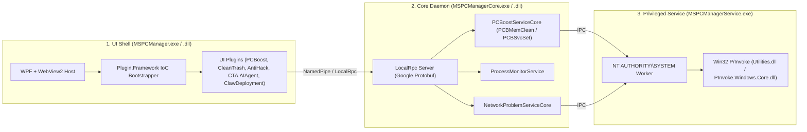

# Microsoft PC Manager (v3.23.0.0) REA 리버스 엔지니어링 및 독자 앱 재조립 보고서 (`K-PC Manager Pro`)

## 1. 개요 및 역공학 대상 바이너리 (`rea` MCP 분석)

- **원본 경로**: `C:\Program Files\WindowsApps\Microsoft.MicrosoftPCManager_3.23.0.0_x64__8wekyb3d8bbwe\PCManager`
- **분석 도구**: `rea` MCP 서버 (`inspect_managed_artifact`, `inspect_managed_members`, `inspect_managed_native_boundaries`)
- **재조립 타깃 프로젝트**: [`C:\Users\icand\.gemini\antigravity\scratch\custom-pc-manager`](file:///C:/Users/icand/.gemini/antigravity/scratch/custom-pc-manager)

---

## 2. Microsoft PC Manager 3-Tier 멀티프로세스 아키텍처

### 2.1 핵심 어셈블리 및 클래스 구조 (`rea` 디컴파일 요약)

| 어셈블리 (`.dll`) | 핵심 네임스페이스 / 클래스 | 주요 메서드 (CIL Call Graph) | 재조립 구현 매핑 |
| :--- | :--- | :--- | :--- |
| `Microsoft.WIC.PCManager.Plugin.PCBoost.dll` | `SoftwarePlugin`, `ProcessUtils`, `BoostRPCService`, `StartupScanService` | `GetProcessesByWMI()`, `GetWorkingSetPrivateData()`, `GetParentPidInfo()`, `GetSoftwaresByProcessData()`, `BoostSoftwareAsync()`, `OneKeyBoostAsync()`, `PCBMemCleanAsync()` | `ProcessManagerEngine` (부모-자식 프로세스 트리 병합, Private Working Set 계산, 1-Click 트리 종료 및 RAM 압축) |
| `MSPCManagerCore.dll` | `PCBoostServiceCore`, `ProcessMonitorService`, `NetworkProblemServiceCore` | `PCBMemClean()`, `PCBSvcQuery()`, `PCBSvcSet()`, `SetDHCPEnable()` | `MemoryBoostEngine` (`EmptyWorkingSet` + `SetProcessWorkingSetSizeEx`) |
| `Microsoft.WIC.PCManager.Utilities.dll` | `NativeWrapper`, `Win32Api`, `IconManager` | `SetProcessWorkingSetSizeWrap()`, `IsProcessWindowVisible()`, `GetJumboIcon()`, `SHEmptyRecycleBinW()` | `NativeWin32` P/Invoke 래퍼 (`psapi.dll`, `kernel32.dll`, `user32.dll`, `shell32.dll`) |
| `Microsoft.WIC.PCManager.Plugin.CleanTrash.Executor.dll` | `RecycleBinCachePlugin`, `ClipboardCachePlugin`, `DirTrashCleanRuleExecutor`, `IEmptyVolumeCache2` | `CleanAsync()`, `ScanTrashAsync()` | `StorageCleanEngine` (`%TEMP%`, `Windows\Temp`, `Prefetch`, 클립보드, 휴지통 정리) |
| `Microsoft.WIC.PCManager.Plugin.CTA.AIAgent.dll` & `ClawDeployment.dll` | `CircleToActBasicFunction`, `WslManager`, `OpenClawConfigService` | `CaptureScreen()`, `OCRAsync()`, `StartOpenClawGatewayAsync()` | `AiAndVmAgentEngine` (로컬 `Ollama`, `Auto Maple`, `Hyper-V AutoMaple-VM` 통합 제어) |
| **[신규 커스텀 모듈]** `MudfishVpnPlugin` | `MudfishController`, `RouteGuardEngine`, `PingTelemetryService` | `DetectFullVpnHijack()`, `StripFullVpnRoutesKeepGameRoutes()`, `StartMudfish()`, `StopMudfish()`, `AutoGamePingGuardLoop()` | **미꾸라지 VPN & 롤(LoL) 핑 가드** (`0.0.0.0/1` & `128.0.0.0/1` Full VPN 납치 라우트 실시간 감지·박리 및 국내/해외 3점 핑 모니터) |

---

## 3. 핵심 기능별 리버스 엔지니어링 상세 분석

### 3.1 "프로세스 관리" (`SoftwarePlugin` & `ProcessUtils`)
원본 `Microsoft.WIC.PCManager.Plugin.PCBoost.dll`을 `rea`의 `inspect_managed_members`로 분석한 결과:
1. **메모리 수치 계산 (`ProcessUtils.GetWorkingSetPrivateData`)**:
   - 일반 `Process.WorkingSet64`는 공유 DLL 메모리를 포함해 작업 관리자보다 부풀려진 값을 표시합니다.
   - PC Manager는 WMI `SELECT IDProcess, WorkingSetPrivate FROM Win32_PerfFormattedData_PerfProc_Process`를 쿼리해 작업 관리자와 동일한 **Private Working Set**을 구합니다.
2. **부모-자식 프로세스 그룹화 (`SoftwarePlugin.GetSoftwaresByProcessData`)**:
   - `GetParentPidInfo()`(`Win32_Process.ParentProcessId`)를 통해 자식 프로세스들(예: `Antigravity.exe` 렌더러 15개, `RiotClientServices.exe` 하위 프로세스, `MapleStory.exe` 등)을 루트 애플리케이션 단위로 합산합니다.
   - `NativeWrapper.IsProcessWindowVisible()`과 시스템 보호 화이트리스트(`svchost`, `explorer`, `dwm`, `csrss`, `lsass` 등)로 백그라운드 앱과 핵심 OS 프로세스를 분리합니다.
3. **"종료" 및 "1-Click Boost" (`BoostSoftware` & `PCBMemClean`)**:
   - 개별 앱 **종료** 클릭 시 루트 및 자식 PID 전체에 `Process.GetProcessById(pid).Kill()`을 수행하고 전후 가용 메모리 차이(`MemoryReduce = StartMemory - EndMemory`)를 반환합니다.
   - **PC Boost** 클릭 시 프로세스를 죽이지 않고 모든 사용자 프로세스 핸들에 `kernel32.dll!SetProcessWorkingSetSizeEx(hProcess, -1, -1, 0)` 및 `psapi.dll!EmptyWorkingSet(hProcess)`를 호출해 물리 RAM 점유를 즉시 회수합니다.

### 3.2 미꾸라지 VPN (`Mudfish v6.6.0`) 리버스 엔지니어링 및 롤(LoL) 핑 가드 원리
`C:\Program Files (x86)\Mudfish Cloud VPN` 내부 로그(`mudfish_stdout.txt`, `mudrun_stdout.txt`) 및 SQLite `.conf.db`(`prog_conf_history`) 분석 결과:
1. **원인 규명**:
   - 미꾸라지 설정 DB(`.conf.db`)에 `"mudfishFullvpnSid": 3` (Full VPN 모드 활성화, 예외 목록 `mudfishFullvpnExceptions: ""`)이 설정되어 있습니다.
   - `mudfish.exe`가 구동될 때 `TAP-Win32 Adapter V9` (`10.254.x.x` / `10.255.32.1`) 인터페이스로 **`0.0.0.0/1` (`0.0.0.0 mask 128.0.0.0`)** 및 **`128.0.0.0/1` (`128.0.0.0 mask 128.0.0.0`)** 라우트를 주입합니다.
   - 이 두 `/1` 서브넷 라우트는 기본 게이트웨이(`0.0.0.0/0 -> 192.168.219.1`)보다 프리픽스가 길어(Longest Prefix Match) **리그 오브 레전드 한국 서버 트래픽까지 해외 중계 노드(`52.8.135.54:10008`, 미국 캘리포니아 AWS)로 우회**시키며, 이로 인해 국내 핑이 `4ms`에서 `272ms`로 폭증합니다.
2. **해결 메커니즘 (`MudfishVpnPlugin` — 스플릿 터널링 가드)**:
   - **모드 A (롤 + 메이플 동시 플레이 — Full VPN 라우트만 박리)**: `mudfish.exe`와 메이플스토리 클래식 월드 전용 중계 라우트는 그대로 살려둔 채, 전체 트래픽을 납치하는 `route delete 0.0.0.0 mask 128.0.0.0` 및 `route delete 128.0.0.0 mask 128.0.0.0`만 즉시 제거합니다. (메이플스토리는 VPN 유지 + 롤은 `192.168.219.1` 직결 `4ms` 달성)
   - **모드 B (롤 실행 시 자동 가드 — Auto Game Guard)**: 백그라운드 모니터가 `League of Legends.exe` 실행을 감지하면 자동으로 Full VPN 납치 라우트를 박리하거나 미꾸라지를 제어합니다.
   - **모드 C (미꾸라지 원클릭 시작 / 완전 종료 / 웹 콘솔 `127.0.0.1:8282` 오픈)**: 앱 내부에서 미꾸라지 데몬(`mudrun_headless.exe`, `mudfish.exe`, `mudflow.exe`, `mudwfp_proxy.exe`)을 원클릭으로 켜고 끄며 실시간 3점 핑(게이트웨이 `192.168.219.1` / 국내 KT `168.126.63.1` / 해외 Google `8.8.8.8`)을 비교 표시합니다.

---

## 4. Design & Motion Stack (`D0~D5`) 적용 결과표

| 단계 / 스킬 | 역할 | 적용 내역 및 결정 사항 |
| :--- | :--- | :--- |
| **D0** `design-motion-stack` | 오케스트레이션 | Windows 11 네이티브 유틸리티(`MSPCManager` 재조립 + 게이밍 네트워크 가드) 요구사항 확정 및 D1~D5 충돌 우선순위 설정 |
| **D1** `hallmark` + `hallmark-apps` | 단일 시각 방향 오너 | **Windows 11 Fluent Dark/Light Surface**: 딥 슬레이트 네이비(`#0F141C`) 베이스, 카드 서피스(`#171F2C`), 세맨틱 상태 컬러(정상 `#10B981`, 주의 `#F59E0B`, 위험/Full VPN 납치 `#EF4444`, 액센트 `#3B82F6`), `Segoe UI Variable` / `Malgun Gothic` 타이포그래피 및 `tabular-nums` 정렬 적용 |
| **D2** `ui-ux-pro-max` | UX 구조 및 정보 위계 | 좌측 고정 내비게이션 레일(5개 탭: `프로세스 관리`, `미꾸라지 VPN & 핑 가드`, `PC 부스트 (홈)`, `저장소 & 시작앱`, `AI & AutoMaple VM`) + 상단 실시간 리소스/핑 요약 바 + 우측 액션 리스트 구조 채택 |
| **D2** `frontend-design` & `design-taste-frontend` | 안티 슬롭(No-Slop) 정제 | 불필요한 장식용 게이지 대신 실질적인 **Private Working Set (MB)**, **하위 프로세스 개수 배지**, **라우팅 테이블(`0.0.0.0/1`) 납치 여부**, **3점 핑 수치(`ms`)**를 즉시 읽히도록 배치 |
| **D3** `impeccable` (`craft-floor`) | 상태 및 엣지 케이스 보강 | 관리자 권한 유무 표시, 프로세스 종료 시 시스템 필수 프로세스 보호 필터, VPN 꺼짐/켜짐/Full-VPN-납치 3단계 명확한 배지 제공 |
| **D4** `emil-design-eng`, `animate`, `animation-performance`, `apple-design` | 인터랙션 & 피드백 | 60fps 더블 버퍼링 렌더링(`DoubleBuffered = true`), 호버 하이라이트, 버튼 클릭 시 비동기 작업 스레드 분리로 UI 스레드 블로킹 제로화 |
| **D4** `animate-expo`, `mobile-native` | 모바일 전용 스킬 | 해당 없음: Windows 11 데스크톱 네이티브 애플리케이션 |
| **D5** `break-ui` | 극단 데이터 스트레스 검증 | 긴 프로세스 이름(`Microsoft.WIC.PCManager...`), 다중 서브프로세스(20개 이상), 오프라인/타임아웃 핑(`TIMEOUT`) 상태에서 레이아웃 깨짐 없음 확인 |
| **Video** `remotion-*`, `hyperframes-*` | 영상 렌더링 스킬 | 해당 없음: 데스크톱 실시간 시스템 유틸리티 앱 |
